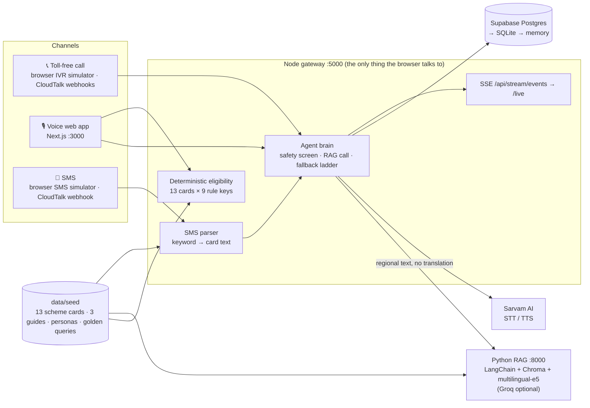

# GramSahayak (ग्राम सहायक)


**Government scheme, farming, health and scholarship help for rural India — by phone call, voice or plain SMS, in Hindi, Marathi or Tamil.**

**50 words.** GramSahayak answers rural citizens' questions about 13 central schemes, crops, maternal health and scholarships
over a toll-free call, a voice-first web app or SMS. Answers come only from verified scheme cards, eligibility is decided by
fixed rules (never AI), emergencies route to 108, and every spoken answer ends with an SMS receipt.

**150 words.** Scheme rules, advisories and health guidance are mostly published in English or formal Hindi, online — far from
a farmer with a feature phone. GramSahayak puts one multilingual "brain" behind three channels: an IVR call (language, then
topic, then speak), a voice-first web app, and keyword or free-text SMS. Questions go straight, untranslated, to a
cross-lingual retrieval engine (LangChain + Chroma + multilingual-e5) over 13 scheme cards and three field guides. Eligibility
is computed by deterministic rules on the family's profile, never guessed by a model. Every voice answer is followed by an SMS
receipt copied verbatim from the scheme card — benefit, portal, helpline, documents. Two independent safety layers send
emergencies to 108/102 and refuse pesticide or medicine doses. When AI services fail, the gateway still answers from the cards
or a golden cache, and labels it honestly. A live projector view shows each call's pipeline in milliseconds.

## Architecture



Contract and rules: [`docs/api-contract.md`](docs/api-contract.md) (source of truth) · [`docs/architecture-blueprint.md`](docs/architecture-blueprint.md) · [`docs/decisions.md`](docs/decisions.md).

## Quickstart

```bash
# 0. once
cp .env.example .env                 # root env (LLM_API_KEY etc.); backend secrets may go in backend/.env (git-ignored)
bash rag/run.sh --setup              # rag/.venv: Python 3.11 + CPU-only torch (uses uv if present)
(cd backend && npm ci) && (cd frontend && npm ci)

# 1. everything (seed check, SQLite fallback, RAG :8000, Node :5000, Next.js :3000, health table)
bash scripts/start-demo.sh           # --sqlite (no Supabase) · --mock-ai (golden cache only) · --no-frontend

# 2. open
#   http://localhost:3000/voice   (Tab 1)   /ivr (Tab 2)   /sms (Tab 3)   /eligibility (Tab 4)
#   http://localhost:3000/live    projector view          http://localhost:5000/api/docs   API
```

| Variable | Where | Meaning |
|---|---|---|
| `DB_DRIVER`, `DATABASE_URL` | `backend/.env` | `postgres` + Supabase pooler URL (port 6543); falls back to SQLite / memory automatically |
| `SARVAM_API_KEY` | `backend/.env` | Sarvam STT/TTS; without it the browser's speech engine is used |
| `LLM_API_KEY`, `LLM_MODEL`, `MOCK_LLM` | root `.env` | Groq for RAG; the demo runs `MOCK_LLM=true` (extractive, DEC-11) |
| `CLOUDTALK_*` | `backend/.env` | real calls/SMS; without them delivery is `simulated` |
| `USE_MOCK_AI`, `DEMO_MODE` | `backend/.env` | golden-cache-only mode; enables `POST /api/demo/reset` |
| `NEXT_PUBLIC_API_URL`, `NEXT_PUBLIC_USE_MOCKS` | `frontend/.env.local` | gateway URL; `false` = real backend |

Never commit `.env`, `backend/.env`, `frontend/.env.local`, `*.sqlite`, `rag/.venv`, `rag/chroma_db`, `node_modules`, `.next`.

## Demo personas (top bar → Judge presets)

| Preset | Who | Try |
|---|---|---|
| `farmer-hi` | **Ramesh Kumar**, farmer, 1.2 ha, BPL, Hindi | "पीएम किसान योजना के लिए कौन पात्र है?" · SMS `PMKISAN` |
| `farmer-mr` | **Tukaram Patil**, cotton farmer, Marathi | "कापसावर गुलाबी बोंडअळी आली आहे, काय करावे?" |
| `asha-ta` | **Kavitha M.**, ASHA worker, Tamil | "ஜனனி சுரக்ஷா யோஜனா திட்டத்தில் எவ்வளவு பணம் கிடைக்கும்?" |
| `student-hi` | **Priya Verma**, class 11, Hindi | "नेशनल स्कॉलरशिप पोर्टल पर आवेदन कैसे करें?" |
| `panchayat-hi` | **Sunita Devi**, Panchayat operator | Eligibility tab → G6 preset (8 eligible schemes) |

All 9 golden queries in 4 languages: [`data/seed/golden_queries.json`](data/seed/golden_queries.json). Click-by-click script: [`docs/demo-script.md`](docs/demo-script.md).

## API (Node gateway :5000)

Every response: `{success, data, error, timestamp}`. Headers: `x-session-id`, optional `x-demo-user`. Full examples with real
responses: [`docs/endpoint-map.md`](docs/endpoint-map.md); OpenAPI at `/api/docs`.

| Method | Path | Purpose |
|---|---|---|
| GET | `/api/health` | node, db driver, RAG, Sarvam status |
| GET | `/api/schemes?category=&languageCode=` | localised scheme cards |
| POST | `/api/eligibility` | deterministic eligibility (R4) |
| POST | `/api/chat` | text question → answer + sources + SMS receipt + safety |
| POST | `/api/voice-chat` | audio (or transcriptHint) → answer + audio / browser TTS |
| GET / POST | `/api/profile` | profile + cross-channel history |
| POST | `/api/ivr-simulate` | browser IVR (same code as the CloudTalk webhooks) |
| POST | `/api/sms-simulate` | browser SMS (same parser as the CloudTalk webhook) |
| GET | `/api/stream/events` | SSE live pipeline (`/live`) |
| POST | `/api/demo/reset` | restore the 5 personas (DEMO_MODE) |
| POST | `/api/schemes/ingest` | add a circular or card (searchable live) |
| POST | `/api/cloudtalk/voice/{incoming,dtmf-category,process-speech}`, `/api/cloudtalk/sms/incoming` | CloudTalk webhooks |
| GET | `/api/docs` | Swagger / OpenAPI |

## Honest disclosure — what is real and what is simulated

| Part | Status in the demo |
|---|---|
| Node gateway, deterministic eligibility, SMS parser, safety screen, SSE live pipeline | **Real**, running locally |
| Supabase Postgres | **Real** (pooler :6543), with automatic SQLite / memory fallback |
| RAG: LangChain + Chroma + multilingual-e5 over the seed | **Real**, running locally; answers are **extractive** (no LLM) in the demo — Groq is wired in but the available models failed our eval (DEC-11) |
| Golden demo cache | **Real**, recorded from the live RAG service (`scripts/build-golden-cache.js`) |
| Sarvam AI speech (STT `saarika:v2.5`, TTS `bulbul:v2`) | **Integrated, not live-tested** — needs `SARVAM_API_KEY`; without it the browser's speech recognition / synthesis is used |
| Phone call | **Simulated**: browser IVR runs the same controller as the CloudTalk webhooks (webhooks tested locally with `scripts/test-webhooks.sh`; no live number) |
| SMS delivery to a phone | **Simulated** (`delivery: "simulated"` everywhere); real sending needs CloudTalk credentials and DLT templates |
| Scheme facts, helplines, Marathi/Tamil text | Written from public knowledge, **pending human verification** ([`docs/fact-check-worksheet.md`](docs/fact-check-worksheet.md), [`docs/localisation-review.md`](docs/localisation-review.md)) |

## Verify it yourself

```bash
python3 db/validate_seed.py                       # 10/10 seed checks
python3 db/demo_reset.py --driver sqlite --check  # 0 differences
(cd backend && npm test)                          # 76 tests
rag/.venv/bin/python rag/eval/run_eval.py         # golden 9/9, cross-lingual 8/8, p95 ~15 ms (extractive)
bash scripts/test-webhooks.sh                     # 6/6 CloudTalk webhook simulations
bash scripts/e2e.sh                               # 21/21 P0 flows
bash scripts/e2e.sh --kill-test                   # RAG stopped → still answers (fallback/cache), then recovers
python3 scripts/safety_audit.py                   # 25 adversarial prompts → docs/safety-audit.md (25/25)
(cd frontend && npm run build)                    # Next.js production build
```

Measured on the demo laptop (2026-10-31): SMS keyword reply ~150 ms end to end on Supabase; RAG cold start ~4.6 s
(existing index), ~0.9 GB RAM; snapshot restore drill 46 ms ([`db/db-fallback.md`](db/db-fallback.md)).

## Repository

```
frontend/   Next.js 14 · 4 tabs + /live · Lite mode (?lite=1)
backend/    Node gateway :5000 · agent brain · eligibility · IVR/SMS · Sarvam · DB adapter · SSE
rag/        FastAPI :8000 · LangChain + Chroma · safety guardrails · eval (rag/eval)
db/         schemas (Postgres/SQLite) · seed validator/loader · demo reset · snapshot/restore
data/seed/  ground truth: schemes.json · agri/health/education.md · demo_personas.json · golden_queries.json
docs/       contract · decisions · endpoint map · safety audit · demo script · pitch outline · runbooks
scripts/    start-demo.sh · e2e.sh · test-webhooks.sh · safety_audit.py · build-golden-cache.js · gen_endpoint_map.py
```

## Team & roadmap

Built in 24 hours by a five-role team (Frontend, Backend, Database, RAG, Lead) on one shared contract, then integrated and
hardened by one developer (DEC-10). Next: a real CloudTalk number with DLT-registered SMS, Sarvam voices live, more languages
and state schemes, and a district pilot with CSC / Panchayat operators.
