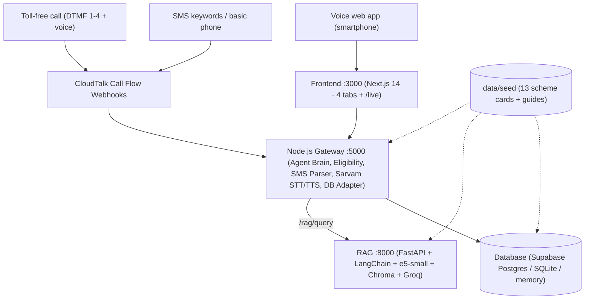

# GramSahayak (ग्राम सहायक)

> **MNIT Sphinx 24H Hackathon · Domain 2.1**
> Omnichannel multilingual assistant for rural Indian citizens across **Toll-Free Voice IVR (CloudTalk + DTMF)**, **Offline SMS**, and a **Voice-First Rural Web App** in Hindi (`hi-IN`), Marathi (`mr-IN`), Tamil (`ta-IN`), and English (`en-IN`).

Single source of truth for all interfaces, schemas, and rules: **[`/docs/api-contract.md`](docs/api-contract.md)** (`contract-v1`).

---

## Architecture Overview



---

## Services & Ports

| Service | Stack | Port | Folder | One-Command Run |
| :--- | :--- | :---: | :--- | :--- |
| **Frontend** | Next.js 14 (App Router, TS, Tailwind) | `:3000` | `/frontend` | `cd frontend && npm install && npm run dev` |
| **Backend Gateway** | Node.js + Express | `:5000` | `/backend` | `cd backend && npm install && npm run dev` |
| **RAG Service** | Python 3.11 + FastAPI + LangChain + Chroma + Groq | `:8000` | `/rag` | `cd rag && python3 -m venv .venv && .venv/bin/pip install -r requirements.txt && .venv/bin/uvicorn app.main:app --host 0.0.0.0 --port 8000` |
| **Database** | Supabase Postgres / SQLite / Memory | — | `/db` | `python3 db/init_sqlite.py` (see [`/db/README.md`](db/README.md)) |

---

## Quick Start (Under 10 Minutes)

1. **Clone & configure environment:**
   ```bash
   git clone https://github.com/samashech/GramSahayak.git
   cd GramSahayak
   cp .env.example .env
   ```
2. **Initialize local SQLite database (zero external credentials needed):**
   ```bash
   python3 db/init_sqlite.py
   ```
3. **Run backend tests / service:**
   ```bash
   cd backend && npm install && npm test
   ```

---

## Environment Variables Summary

| Variable | Default / Example | Used By | Purpose |
| :--- | :--- | :--- | :--- |
| `PORT` | `5000` | Backend | Node gateway HTTP port |
| `FRONTEND_ORIGIN` | `http://localhost:3000` | Backend | Comma-separated allowed CORS origins |
| `AI_RAG_URL` | `http://localhost:8000` | Backend | Internal URL for RAG service |
| `DB_DRIVER` | `memory` / `sqlite` / `postgres` | Backend, DB | Active persistence driver (auto-falls back to memory) |
| `DATABASE_URL` | *(Supabase pooler :6543)* | Backend, DB | Postgres connection string when `DB_DRIVER=postgres` |
| `SQLITE_PATH` | `data/gram_sahayak.sqlite` | Backend, DB | Local SQLite DB file path |
| `SARVAM_API_KEY` | — | Backend | Sarvam AI STT / TTS / translation |
| `LLM_API_KEY` | — | Backend, RAG | Shared Groq API key |
| `LLM_MODEL` | `llama-3.3-70b-versatile` | Backend, RAG | Groq model identifier |
| `CLOUDTALK_API_KEY_ID` | — | Backend | CloudTalk REST API key ID |
| `CLOUDTALK_API_SECRET` | — | Backend | CloudTalk REST API secret |
| `CLOUDTALK_WEBHOOK_SECRET` | — | Backend | Webhook verification secret |
| `TRANSLATE_PIVOT` | `false` | Backend, RAG | Must stay `false` (Rule R6) |
| `USE_MOCK_AI` | `false` | Backend | Force mock/cache AI responses |
| `DEMO_MODE` | `true` | Backend | Enables `POST /api/demo/reset` |
| `APP_ENV` | `development` | All | `development` \| `production` (guards destructive DB scripts) |
| `EMBED_MODEL` | `intfloat/multilingual-e5-small` | RAG | Multilingual embedding model |
| `CHROMA_DIR` | `rag/chroma_db` | RAG | Persistent Chroma vector directory |
| `RAG_TOP_K` | `4` | RAG | Top-K retrieved chunks |
| `RAG_MATCH_THRESHOLD` | `0.80` | RAG | Similarity threshold for `matched_scheme_id` |
| `MOCK_LLM` | `false` | RAG | Force extractive fallback without calling Groq |
| `NEXT_PUBLIC_API_URL` | `http://localhost:5000` | Frontend | Node gateway base URL (`frontend/.env.local`) |
| `NEXT_PUBLIC_USE_MOCKS` | `false` | Frontend | Run UI against `/frontend/mocks` without backend |

---

## Demo Personas (`x-demo-user`)

*(All phone numbers are synthetic demo identifiers — see Contract Section 12.)*

| Preset (`x-demo-user`) | Name | Role | Language | Demo Phone | Key Profile Attributes |
| :--- | :--- | :--- | :--- | :--- | :--- |
| `farmer-hi` | Ramesh Kumar | `farmer` | `hi-IN` | `+919829011111` | 1.2 ha, BPL, age 45, male, ₹90,000/yr, OBC |
| `farmer-mr` | Tukaram Patil | `farmer` | `mr-IN` | `+919822022222` | 1.8 ha, non-BPL, age 50, male, ₹1,80,000/yr, General |
| `asha-ta` | Kavitha M. | `asha` | `ta-IN` | `+919840033333` | 0 ha, non-BPL, age 34, female, ₹1,20,000/yr, General |
| `student-hi` | Priya Verma | `student` | `hi-IN` | `+919829044444` | 0 ha, non-BPL, age 16, female, ₹90,000/yr, OBC |
| `panchayat-hi` | Sunita Devi | `panchayat` | `hi-IN` | `+919829055555` | 0 ha, non-BPL, age 40, female, ₹1,50,000/yr, General |

---

## Team Roles & Folder Ownership

| Role | Folder Ownership | Scope | Context File |
| :--- | :--- | :--- | :--- |
| **Frontend** | `/frontend` | Next.js 14 UI (4 tabs + `/live`), typed client, mocks, Lite mode | `/frontend/CLAUDE.md` (template in [`docs/role-context-blocks.md`](docs/role-context-blocks.md)) |
| **Backend Lead** | `/backend` | Node gateway `:5000`, Sarvam, CloudTalk IVR/SMS, deterministic eligibility, DB adapter | [`/backend/CLAUDE.md`](backend/CLAUDE.md) |
| **Database** | `/db` (+ repo bootstrap & seed validation) | Repo + Git rules, Postgres/SQLite schemas, seed validator/loader, Supabase, snapshots | [`/db/CLAUDE.md`](db/CLAUDE.md), [`/db/ROLE.md`](db/ROLE.md) |
| **RAG Chatbot** | `/rag` | FastAPI `:8000`, LangChain + Chroma + Groq, safety guardrails, golden eval | `/rag/CLAUDE.md` (template in [`docs/role-context-blocks.md`](docs/role-context-blocks.md)) |
| **Team Lead** | `/docs`, `/scripts` | CloudTalk trial, human fact-check, e2e QA, safety audit, demo & pitch | [`/docs/role-context-blocks.md`](docs/role-context-blocks.md) |

See **[`/docs/team-protocol.md`](docs/team-protocol.md)** for Git workflow, PR rules, and merge-conflict recovery.
