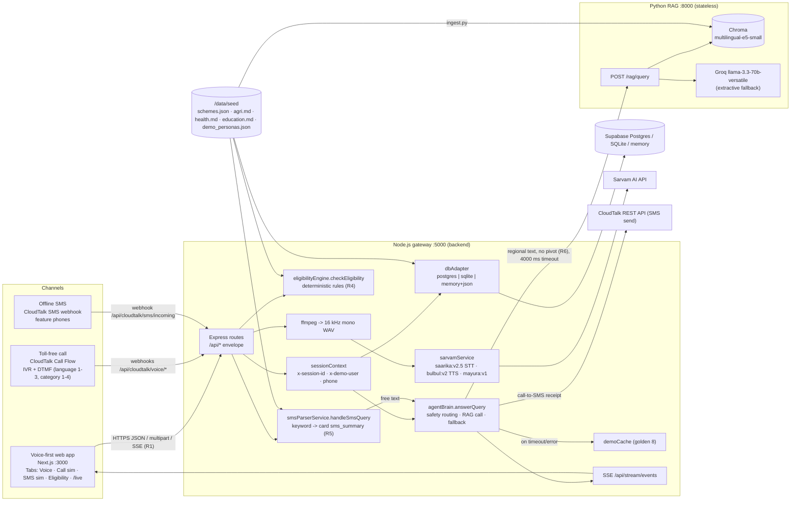
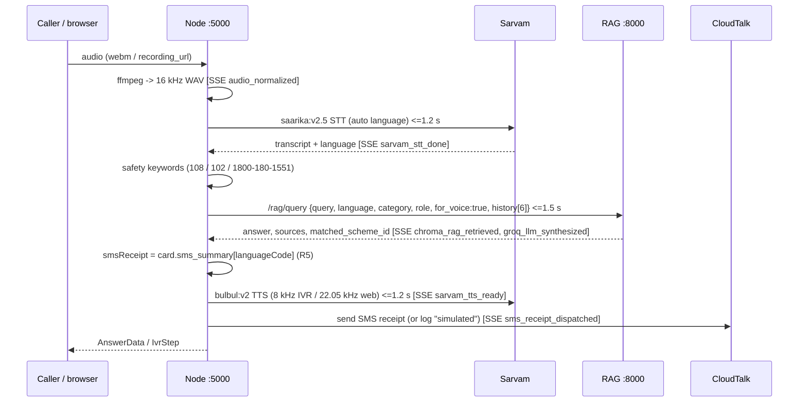

# GramSahayak (ग्राम सहायक) — Architecture Blueprint

Companion to `/docs/api-contract.md` (Contract v1). Where they differ, the contract wins.

## 1. System diagram

Every channel ends in the Node gateway. Only the gateway talks to Sarvam, CloudTalk, the database and the RAG service (R1, R3). The RAG service answers one question at a time and keeps no state (R2). The scheme cards in `/data/seed` feed the RAG index, the deterministic eligibility engine and the database, so all three agree (R7).

## 2. One voice turn (target < 4.5 s)

## 3. Degradation ladder (the demo never fails)

| Failure | Node behaviour | `source` |
|---|---|---|
| RAG down / > 4000 ms | local card match by code / name keywords | `fallback` |
| No card match | golden demo cache | `cache` |
| `USE_MOCK_AI=true` | demo cache first, then local card match | `cache` / `fallback` |
| Sarvam STT fails | use `transcriptHint` from browser SpeechRecognition, else `ERR_STT_FAILED` | — |
| Sarvam TTS fails | `audioBase64:null`, `useBrowserTts:true` | — |
| DB unreachable | dbAdapter falls back to memory + `/data/seed` | — |
| CloudTalk SMS fails / DLT | receipt `delivery:"simulated"` or `"failed"` | — |

## 4. Backend module map (`/backend/src`)

| Folder | Files | Prompt |
|---|---|---|
| `config/` | `index.js` (env, languages, categories, roles) | B-01 |
| `utils/` | `response.js` (envelope), `logger` | B-01 |
| `middlewares/` | `errorHandler.js`, `upload.js`, `sessionContext.js`, `offlineFallback.js` | B-01, B-04, B-10 |
| `adapters/` | `dbAdapter.js` + drivers `memoryDriver`, `sqliteDriver`, `postgresDriver` | B-02 |
| `services/` | `sessionService`, `seedService`, `eligibilityEngine`, `smsParserService`, `agentBrain`, `sarvamService`, `cloudtalkService`, `eventBus` | B-02 … B-08 |
| `controllers/` | `cloudtalkController.js`, others | B-07 |
| `routes/` | `health`, `schemes`, `profile`, `chat`, `demo`, `cloudtalk`, `simulate`, `stream` | B-01 … B-08 |

## 5. Contract change requests found while writing this blueprint

None blocking. Notes for the Lead are listed in the A-00 / K-01 hand-off message.
